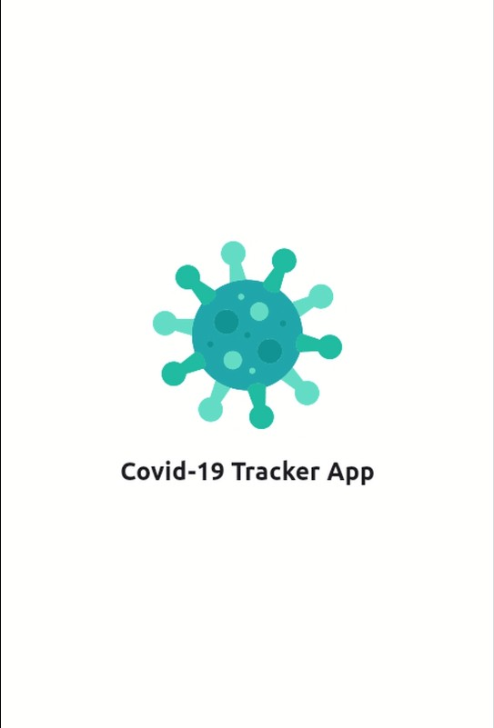
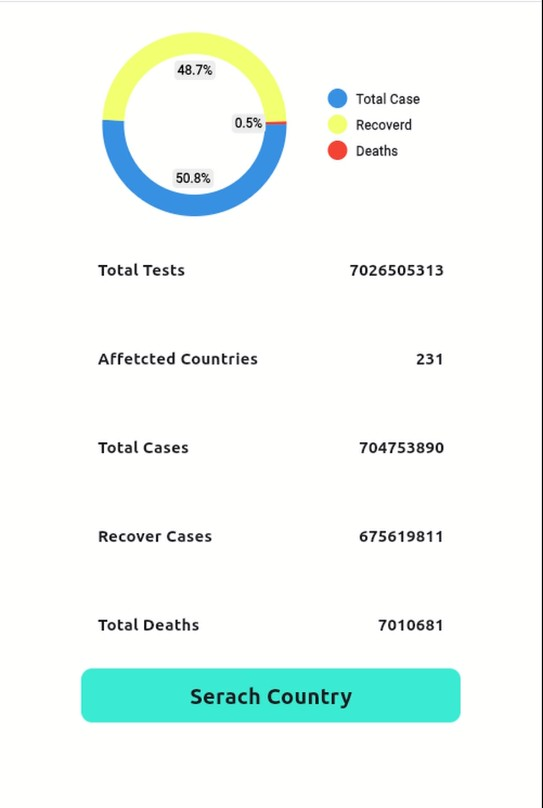

# 🦠 Covid-19 Tracker App

A clean and responsive **Flutter** mobile application that tracks real-time global and country-specific Covid-19 statistics using live REST APIs.

## ✨ Features

- **Splash Screen:** Smooth animated entry screen with app branding.
- **Global Statistics Dashboard:** Displays overall global data including Total Tests, Affected Countries, Total Cases, Recovered Cases, and Total Deaths.
- **Visual Data Chart:** Interactive pie/donut chart breaking down the percentage of Total Cases, Recovered, and Deaths.
- **Country Search:** Real-time search functionality with country flags to quickly find specific country statistics.

## 📱 Screenshots

| Splash Screen | Global Dashboard | Country Search |
| :---: | :---: | :---: |
|  |  |  |

## 🛠️ Built With

- **Framework:** [Flutter](https://flutter.dev)
- **Language:** Dart
- **API:** [disease.sh - Open Disease Data API](https://disease.sh)
- **Packages Used:** `http`, `pie_chart`, `flutter_spinkit`

## 🚀 Getting Started

Follow these steps to run the project locally on your machine:

1. **Clone the repository:**
   ```bash
   git clone https://github.com/muhmmadFaheem/crona_app.git
   ```
2. **Navigate to the project directory:**
   ```bash
   cd crona_app
   ```
3. **Install dependencies:**
   ```bash
   flutter pub get
   ```
4. **Run the app:**
   ```bash
   flutter run
   ```

## 👨‍💻 Author

- **Muhammad Faheem** - [@muhmmadFaheem](https://github.com/muhmmadFaheem)

## 🤝 Contributing

Contributions, issues, and feature requests are welcome! Feel free to check the [issues page](https://github.com).
